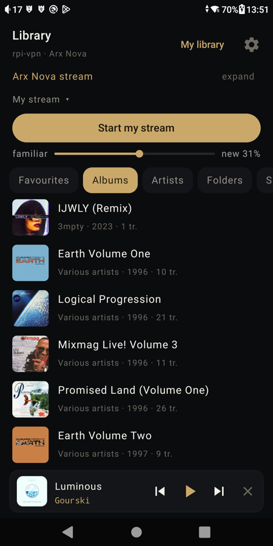
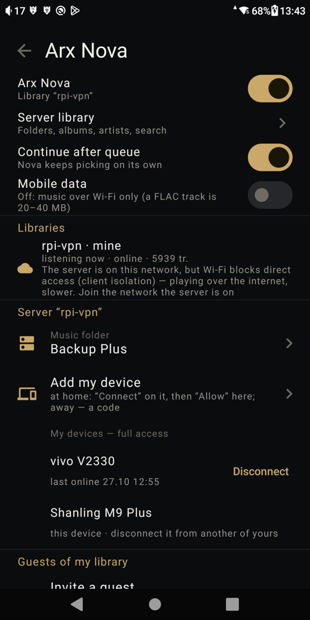

# Arx Nova — your music library server for Arx Player

[Русская версия → README.md](README.md)

Arx Nova runs on your own computer (Mac, Windows, Linux, Raspberry Pi) next to your music and
gives the Arx Player Android app two things:

- **your library in the player from anywhere in the world** — straight from your computer,
  encrypted, no clouds or middlemen; bit-perfect, as if the files were on the memory card;
- **a stream "to your taste"** — the next track is picked by how it sounds, and the picker learns
  from what you play, skip and like. Everything is computed at home.

You can invite up to 5 close people: each has their own taste profile and never changes yours.

<p align="center">
  
  &nbsp;&nbsp;
  
</p>

## Requirements

- **A computer** that stays on while you listen: Apple Silicon Mac (macOS 12+), Windows 10/11,
  Linux x86_64 or Raspberry Pi 4/5 (64-bit). Nothing to install beforehand — no Python, no
  libraries: the installer brings everything.
- **Disk space:** the server ~200 MB; the sound model 18 MB (downloaded with your consent);
  deep-analysis components ~3 GB — only if you enable them yourself.
- **Library:** FLAC (including CUE images), WAV, AIFF, OGG Vorbis / Opus, MP3. ALAC/AAC (m4a), WMA
  and DSD play from the device itself for now — server support is planned.
- **Player:** Arx Player on Android 8+ (the build with Arx Nova).

## Install

Download the installer for your system from the
[**Releases**](https://github.com/ArxSecretorum/arxnova/releases/latest) page:

| System | File |
|---|---|
| macOS 12+ on Apple Silicon (M1 and newer) | `ArxNova-…-macOS-arm64.dmg` — drag "Arx Nova" to Applications |
| Windows 10/11 | `ArxNova-…-Windows-x64-setup.exe` |
| Linux, Raspberry Pi | `arxnova_…_amd64.deb` / `…_arm64.deb` |

Open "Arx Nova" and take three steps in the window:

1. **Choose the folder** with your music.
2. Agree to download the sound model.
3. **Start.**

The app does the rest: downloads the model, enables autostart, analyses the library. Then press
**"Connect player"** and enter the 6 digits in Arx Player (Settings → Arx Nova). You can close the
window — the server keeps running and starts on its own.

> The app is not yet signed with an Apple / Microsoft certificate. First launch on a Mac:
> right-click "Arx Nova" → "Open" → "Open". On Windows: "More info" → "Run anyway".

**Without a window (a server, a headless Raspberry Pi)** — one command in the terminal:

```sh
curl -LsSf https://raw.githubusercontent.com/ArxSecretorum/arxnova/main/install.sh | sh
```

```powershell
irm https://raw.githubusercontent.com/ArxSecretorum/arxnova/main/install.ps1 | iex
```

## Listening away from home

The server asks your router to open one port by itself (UPnP / NAT-PMP / PCP) and tells the
player how to reach it. The link is TLS with a key the player pins when it first connects at
home: your server cannot be impersonated. If your ISP changes your home address, the player
finds the server through the BitTorrent DHT — no address server of anyone's.

If the port cannot be opened (two routers in a row, a carrier-grade NAT), the player and the
server meet through the same DHT and punch through NAT towards each other: an encrypted channel
over UDP (ECDH + AES-256-GCM, server key pinned), no relays. The "Check and set up the network"
button in the server window shows which path worked.

## Library analysis

The server watches your music folder: add an album and it is analysed half a minute after copying
(no polling — file-system events). The overall sound is computed right away. To let Nova
understand styles, rhythm, vocals, tempo and scenarios ("for running", "mysterious"), the window
has a **"Download analysis components"** button (~3 GB: Demucs, torch, LAION CLAP) — once, with
your consent; everything stays on your computer. Transitions between styles go only through the
"gate"; **"Tune the stream"** opens the gate panel and the bridge labelling.

## Guests

`arxnova invite <name>` or in the player: Settings → Arx Nova → "Invite". An invitation is
personal, single-use and valid for 24 hours. At most 5 guests, no more than two listening at the
same time. Revoke: `arxnova guests --revoke <number>` or in the player.

Personal listening only: playing guests' music in venues, on air or in broadcasts is not allowed.
The library owner is responsible for the legality of their files.

## Privacy

Nothing about your music or listening leaves your home — not to the developer, not to anyone:
history and taste live in a database on your computer. The server goes online only to learn its
public address (STUN), open a port on the router and announce "I am here" in the DHT — without
titles or tracks. Library telemetry (ONNX Runtime, FastAPI) is switched off.

## Sound model

The sound is analysed by the Discogs-EffNet and MAEST models (Music Technology Group, Universitat
Pompeu Fabra, https://essentia.upf.edu/models.html), licence CC BY-NC-SA 4.0. They are not bundled
with the server: the installer downloads them from the MTG site only with your consent.

## Commands

| Command | What it does |
|---|---|
| `arxnova doctor` | check: model, library, autostart, reachability from outside |
| `arxnova pair` | code to connect your own player |
| `arxnova invite <name>` / `arxnova guests` | invitations and guests |
| `arxnova service install / remove / status` | autostart |
| `arxnova setup --library <folder>` | change the music folder |

Uninstall: `arxnova service remove`, then `uv tool uninstall arxnova`.

## License

Arx Nova is licensed under [PolyForm Strict 1.0.0](LICENSE). In plain words:

- **Free** for your own use: listen to your music, invite friends as guests, study, research.
  Noncommercial, educational and government organizations may use it too.
- **No** commercial use: not inside a company's business, a paid product or a paid service.
- **No** changes and no redistribution. Share a link to this page instead: installers come only
  from the [releases](https://github.com/ArxSecretorum/arxnova/releases) section.

Commercial licenses are available on request via
[Issues](https://github.com/ArxSecretorum/arxnova/issues). The legal text is the one in
[LICENSE](LICENSE).

Third-party libraries keep their own licenses: their texts ship with the installed application
(THIRD_PARTY_LICENSES.txt), and the sources of the LGPL libraries are attached to every release.
