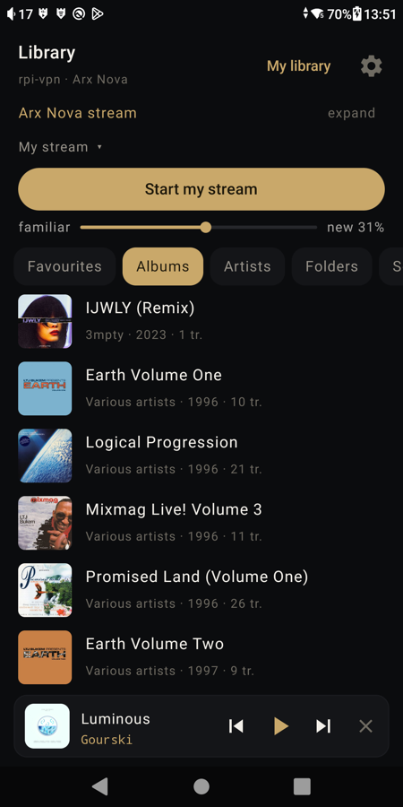
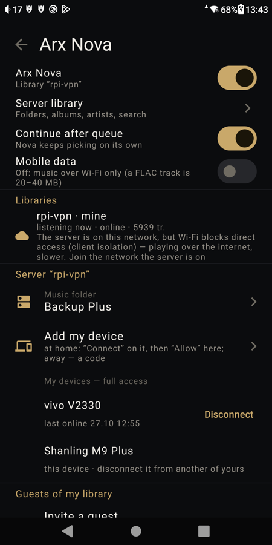

# Arx Nova — сервер вашей медиатеки для Arx Player

[English version → README.en.md](README.en.md)

Arx Nova живёт на вашем компьютере (Mac, Windows, Linux, Raspberry Pi) рядом с музыкой и даёт
Arx Player две вещи:

- **вашу медиатеку в плеере из любой точки мира** — напрямую с вашего компьютера, с шифрованием,
  без облаков и посредников; bit-perfect, как с карты памяти;
- **поток «по вашему вкусу»** — подбор следующего трека по звучанию, который учится на том,
  что вы слушаете, пропускаете и лайкаете. Всё считается у вас дома.

Можно пригласить до 5 близких: у каждого свой вкус, ваш он не меняет.

<p align="center">
  
  &nbsp;&nbsp;
  
</p>

## Требования

- **Компьютер**, который включён, пока вы слушаете: Mac на Apple Silicon (macOS 12+),
  Windows 10/11, Linux x86_64 или Raspberry Pi 4/5 (64-бит). Ничего ставить заранее не нужно —
  ни Python, ни библиотек: установщик приносит всё сам. Серверу хватает 1,2 ГБ памяти; разбор
  медиатеки добавляет около 1 ГБ, пока идёт.
- **Что даёт какой компьютер.** Поток «по вкусу» работает на любом из них сразу после первого
  прохода (общее звучание и стили — модель 18 МБ). Разница — в глубоком разборе: стили точнее
  (MAEST), голос, сценарии, темп по долям. Числа — на медиатеке в 5 000 треков, фоном:

  | Компьютер | Глубокий разбор | Сколько ждать | Чего не будет |
  |---|---|---|---|
  | **Mac на Apple Silicon** (M1 и новее) — рекомендуем | весь, на графическом ядре: ~10 с на трек | около 14 часов | — |
  | **ПК с Windows / Linux** | весь, на процессоре (4 ядра): стили 6–10 с, голос ~70 с на трек; видеокарта NVIDIA ускоряет только стили | 4–5 суток | — (на живой Windows пока не проверено) |
  | **Raspberry Pi 5** (8 ГБ, только под сервер) | стили MAEST ~1 мин на трек; темп по долям и сценарии — по силам, но не замерены; голос (Demucs) ≈ 5 мин на трек — недели на медиатеку | 3–4 суток до точных стилей | плитки «вокал» — только с помощником |
  | **Raspberry Pi + любой из компьютеров выше в той же сети** | весь, на том компьютере (см. «Разбор медиатеки») | как у него | — |

  Raspberry Pi 4 заявлен, но не проверялся; замеры — Pi 5 с 8 ГБ. Если на Pi рядом живут другие службы и серверу
  отведено меньше памяти (например, 3 ГБ), глубокий разбор на нём не запустится вовсе — тогда помощник.
- **Место на диске:** сервер ~200 МБ; модель звука 18 МБ (скачивается с вашего согласия); база и
  разбор ~400 МБ на 6 000 треков; компоненты глубокого анализа ~3 ГБ на Mac и до 6 ГБ на Linux —
  только если включите их сами.
- **Медиатека:** FLAC, WAV, AIFF, OGG Vorbis / Opus, MP3, ALAC и AAC (m4a), WMA, DSD (dsf, dff), APE,
  WavPack, TTA; образы с CUE. Для разбора звука ALAC, AAC, WMA, DSD, APE, WavPack и TTA нужна программа
  ffmpeg: `sudo apt install ffmpeg`, `brew install ffmpeg` или `winget install ffmpeg`. Без неё эти файлы
  в медиатеке есть и играют, но в поток «по вкусу» не попадают. Остальное разбирается и без неё.
- **Плеер:** Arx Player на Android 8+ (в сборке с Arx Nova).

## Установка

Скачайте установщик для своей системы со страницы
[**Релизы**](https://github.com/ArxSecretorum/arxnova/releases/latest):

| Система | Файл |
|---|---|
| macOS 12+ на Apple Silicon (M1 и новее) | `ArxNova-…-macOS-arm64.dmg` — перетащите «Arx Nova» в «Программы» |
| Windows 10/11 | `ArxNova-…-Windows-x64-setup.exe` |
| Linux, Raspberry Pi | `arxnova_…_amd64.deb` / `…_arm64.deb` |

Откройте «Arx Nova» и сделайте три шага в окне:

1. **Выбрать папку** с музыкой — обычным проводником.
2. Отметить согласие скачать модель звука.
3. **Запустить.**

Всё остальное приложение делает само: скачивает модель, включает автозапуск, разбирает
медиатеку. Потом нажмите **«Подключить плеер»** и введите 6 цифр в Arx Player
(Настройки → Arx Nova). Окно можно закрыть — сервер работает и запускается сам.

> Приложение пока не подписано сертификатом Apple / Microsoft. При первом запуске на Mac:
> правой кнопкой по «Arx Nova» → «Открыть» → «Открыть». В Windows: «Подробнее» →
> «Выполнить в любом случае».

**Без окна (сервер, Raspberry Pi без экрана)** — одна команда в терминале:

```sh
curl -LsSf https://raw.githubusercontent.com/ArxSecretorum/arxnova/main/install.sh | sh
```

```powershell
irm https://raw.githubusercontent.com/ArxSecretorum/arxnova/main/install.ps1 | iex
```

## Слушать вне дома

Сервер сам просит роутер открыть один свой порт (UPnP / NAT-PMP / PCP) и сообщает плееру, как
до него достучаться. Связь — TLS с ключом, который плеер запоминает при подключении дома:
подменить ваш сервер нельзя. Если провайдер сменит адрес дома, плеер найдёт сервер через
торрент-сеть DHT — без чьего-либо сервера адресов.

Если порт открыть нельзя (два роутера подряд, серый адрес у провайдера), плеер и сервер
договариваются о встрече через ту же DHT и пробивают NAT навстречу друг другу: защищённый
канал поверх UDP (ECDH + AES-256-GCM, ключ сервера закреплён), без ретрансляторов. Кнопка
«Проверить и настроить сеть» в окне сервера покажет, какой путь сработал.

## Разбор медиатеки

Сервер сам следит за папкой с музыкой: добавили альбом — через полминуты после копирования он
разобран (без опроса по таймеру — по событиям системы). Общее звучание считается сразу. Чтобы
Nova понимала стили, ритм, вокал, темп и сценарии («для бега», «мистическая»), в окне есть кнопка
**«Скачать компоненты анализа»** (~3 ГБ: Demucs, torch, Beat This!, CLAP LAION) — один раз, с вашего согласия;
всё остаётся на компьютере. Переходы между стилями идут только через «шлюз»; кнопка **«Настроить
поток»** открывает панель шлюза и разметку мостов.

**Если сервер слабый** (на Raspberry Pi стили, голос, CLAP и темп по долям считаются очень долго), считать может другой компьютер в
той же сети. Поставьте на него Arx Nova и в его окне включите **«Анализ медиатеки на другом компьютере по локальной
сети»**, выберите компьютер с медиатекой и подтвердите доступ в Arx Player или кнопкой на корпусе Pi. Новая музыка будет
разбираться сама, пока оба компьютера в одной сети и считающий работает от сети, а не от батареи. Файлы приходят только по
домашней сети и удаляются после разбора; этот доступ не открывает ничего, кроме разбора.

## Гости

`arxnova invite <имя>` или в плеере: Настройки → Arx Nova → «Пригласить». Приглашение
поимённое, одноразовое, действует 24 часа. Гостей — не больше 5, слушают одновременно не
больше двух. Отозвать доступ: `arxnova guests --revoke <номер>` или в плеере.

Только для личного прослушивания: включать музыку гостей в заведениях, в эфире и на
трансляциях нельзя. За законность своих файлов отвечает владелец медиатеки.

## Приватность

Ничего о вашей музыке и прослушиваниях не уходит ни разработчику, ни кому-то ещё: история и
вкус хранятся в базе на вашем компьютере. Наружу сервер ходит только чтобы узнать свой внешний
адрес (STUN), открыть порт на роутере и объявить «я здесь» в DHT — без названий и треков.
Телеметрия библиотек (ONNX Runtime, FastAPI) выключена.

## Модель звука

Разбор звучания делают модели Discogs-EffNet и MAEST (Music Technology Group, Universitat
Pompeu Fabra, https://essentia.upf.edu/models.html), лицензия CC BY-NC-SA 4.0. Они не входят в
сервер: установщик скачивает их с сайта MTG только с вашего согласия.

## Команды

| Команда | Что делает |
|---|---|
| `arxnova doctor` | проверка: модель, медиатека, автозапуск, связь вне дома |
| `arxnova pair` | код для подключения своего плеера |
| `arxnova invite <имя>` / `arxnova guests` | приглашения и гости |
| `arxnova service install / remove / status` | автозапуск |
| `arxnova setup --library <папка>` | сменить папку с музыкой |

Удалить: `arxnova service remove`, затем `uv tool uninstall arxnova`.

## Лицензия

Arx Nova распространяется по лицензии [PolyForm Strict 1.0.0](LICENSE). Простыми словами:

- **Можно бесплатно** пользоваться сервером для себя: слушать свою музыку, звать друзей-гостей,
  учиться, исследовать. Некоммерческие, учебные и государственные организации тоже могут.
- **Нельзя** использовать его в коммерческих целях: в работе компании, в платном продукте или
  платном сервисе.
- **Нельзя** изменять программу и раздавать её копии. Делитесь ссылкой на эту страницу:
  установщики — только из раздела [выпусков](https://github.com/ArxSecretorum/arxnova/releases).

Коммерческая лицензия — по договорённости, пишите через
[Issues](https://github.com/ArxSecretorum/arxnova/issues). Юридическую силу имеет английский
текст в файле [LICENSE](LICENSE).

Сторонние библиотеки остаются под своими лицензиями: их тексты лежат в установленной программе
(THIRD_PARTY_LICENSES.txt), исходники библиотек под LGPL приложены к каждому выпуску.

---

**English:** see [README.en.md](README.en.md).
